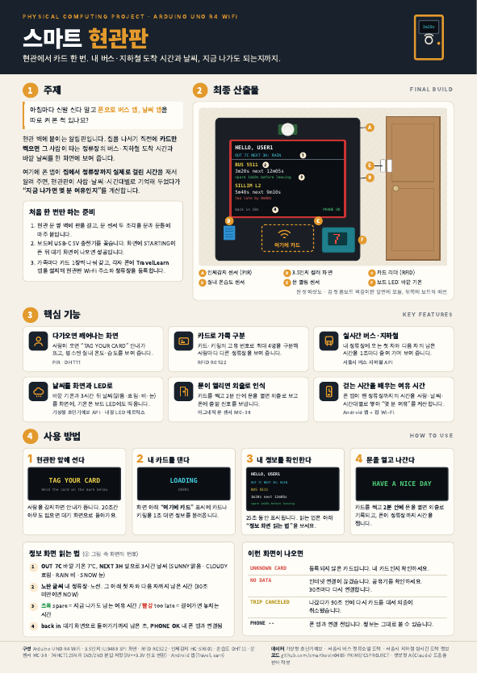

<!-- 이 문서는 생성형 AI(Claude)의 도움을 받아 작성했습니다. -->
# 스마트 현관판 포스터

- `smart-entrance-poster-B4.pdf`: 제출용 포스터 (B4 250×353mm, 1페이지)
- `poster.html`: 포스터 원본. 크롬에서 열어 인쇄(여백 없음, 배경 그래픽 켜기)하면 같은 PDF가 나온다
- `preview.png`: 미리보기

## 내용 기준 (2026-11-26)

- 서보 다이얼은 쓰지 않는다(PR #8). 날씨는 화면의 `OUT 7C NEXT 3H: RAIN` 줄과 보드 LED(바깥 기온)로만 보여 준다
- 화면 문구와 시간(안내 20초, 정보 25초, 외출 판단 2분, 외출 취소 90초)은 `entrance-board/SmartEntrance`의 코드와 같다
- 최종 산출물 그림은 완성 예상도다. 화면이 도착하면 실물 사진으로 바꾼다
- 화면 예시의 이름과 정류장(USER1, BUS 5511, SILLIM L2)은 `config.h`의 예시 값이다
